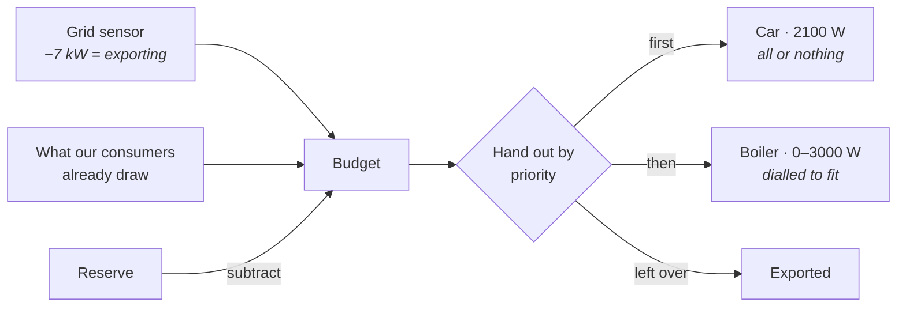

# Solar Router

[![hacs][hacs-badge]][hacs-url]
[![release][release-badge]][release-url]
[![license][license-badge]](LICENSE)

**Spend your own solar power instead of exporting it — on whatever matters most
to you, first.**

Most solar diverters drive a single load and stop there. This one takes a list
of consumers, each with a **priority**, and cascades the surplus down that list
every cycle. Hot water before the car. The car before the pool pump. The pool
pump before the grid.

Point it at the sensor that reports your grid power, add your consumers, and it
works out how much you're about to give away and spends it in your order.
Devices with an adjustable power setting are dialled to whatever fits; on/off
devices are switched on once their full draw fits.

It's reactive, not predictive. No weather forecast, no price optimisation — it
looks at what's happening right now and divides it up. If you want forecasting,
use [EMHASS](https://github.com/davidusb-geek/emhass).



---

## Priorities are the point

A priority is just a number, and **the lower one goes first**.

Here is what that buys you. Same two devices throughout; the only things that
change are which one holds the lower number, and how much sun there is:

```text
4000 W of surplus  ·  boiler 10, car 20
   boiler  ██████████████████████████████  3000 W  full
   car     ·····················              0 W  off, 1000 W is too little

4000 W of surplus  ·  car 10, boiler 20
   car     █████████████████████           2100 W  on
   boiler  ███████████████████             1900 W  the remainder

2000 W of surplus  ·  car 10, boiler 20
   car     ·····················              0 W  off, it needs 2100 W
   boiler  ████████████████████            2000 W  takes the lot
```

The first two are the same 4000 W split two ways. Same roof, same weather, same
hardware — one number decides whether your water gets hot or your car gets
charged.

The third is the case that makes priorities safe to hand out. The car is first
in line, but 2000 W will not start a 2100 W charger, so it stands aside and the
boiler takes everything. **A consumer that cannot use its share never blocks the
ones below it.** The car only wins from 2100 W upwards.

That split is recalculated every cycle against whatever surplus exists right
then, so the order keeps holding as the day moves. With the boiler first:

| Surplus | Boiler | Car |
|--:|---|---|
| 5500 W | 3000 W, full | **on** at 2100 W — it fits |
| 4000 W | 3000 W, full | **off** — only 1000 W left |
| 1200 W | 1200 W, throttled | **off** — nothing left |
| 0 W | off | off |

Each consumer also has a **Managed** switch. Turning it off takes that consumer
off the list entirely, and everything below it moves up.

## Staying under your main fuse

Surplus is not the only limit. A 3 kW boiler and a 3.7 kW charger on the same
phase, with the kitchen running, can trip a 25 A fuse while the roof is still
exporting on the other two phases.

Give the hub a current sensor for each phase you want guarded, plus its limit,
and tell each consumer which phase it is on. The router then:

- **won't start** a consumer when that would push its phase over the limit, and
  dials a modulating one down to what still fits;
- **switches it off straight away** when the phase is over its limit, whatever
  caused it. The fuse comes first, even before the minimum on time.
- counts the consumers it starts in the same cycle against each other, because
  they share the one fuse.

The phase room is worked out as `limit − (measured current − this consumer's
own draw)`. A consumer is not held responsible for the current it causes
itself. Every time the limit actually cuts something off, the router fires a
`solar_router_phase_limit` event with the consumer, phase, current and limit, so
you can hang a notification on it.

A phase without a sensor, or with one that can't be read, is simply not
limited. Neither is a consumer set to **Not limited**.

## Forcing a consumer

Sometimes you want the car charged by tomorrow morning, sun or not. Each
consumer has a **Force on** switch for that. A forced consumer runs at its
maximum regardless of the surplus, **but still under its phase limit**: if the
phase goes over, it is switched off like anything else and starts again by
itself once there is room, after its minimum off time.

That is the difference from switching **Managed** off and running the device by
hand: then the router lets go of it entirely, phase guard included. Force on
survives a Home Assistant restart, so a forced charge doesn't quietly stop
halfway through the night.

## How the budget is worked out

```
budget = current export + what our own consumers already draw − reserve
```

Adding back your own draw is essential. Without it, switching the boiler on
makes the export disappear, which looks like a shortage, which switches the
boiler off again — and round it goes. With it, the budget stays stable and each
consumer simply holds its share.

## Getting the timing right

The router writes a setpoint, the device ramps up, and only then does your meter
notice — in that order, and none of it is instant. Add those up and you get the
loop's dead time, which is the single thing that decides whether the router
settles or hunts up and down all afternoon.

Two settings control it, and **setting them too tight is what makes it
oscillate**:

| Setting | What it does |
|---|---|
| **Recalculate every** | How often a decision gets made at all |
| **Settle** | Extra wait after acting, on top of waiting for a fresh meter reading |

Deciding faster than your dead time doesn't make the router quicker, it makes it
wrong. It acts, sees no effect yet — because the meter is still describing the
world from before — acts again on that stale picture, and then has to unwind
both steps. The result is a boiler that swings between full and off every few
seconds, and it looks exactly like a bug in the allocation logic. It isn't. It's
the timing.

**So measure your dead time instead of guessing at it.** You need two numbers:
how often your grid meter publishes a new value, and how long your device takes
before that change shows up there. A P1 meter on a 10 s cycle plus a boiler that
responds in about 1.5 s gives you roughly 11 s. Set the interval and the settle
time around that and never below it — 15 s each, in that example.

Erring high costs you very little: a slightly sluggish router still spends the
same surplus, just a few seconds later. Erring low costs you the stability of
the whole thing.

The router already refuses to decide twice on the same meter reading, so settle
is a margin *on top of* that. It's there for devices that accept a setpoint
immediately but take a while to actually draw the power.

**Settle is deliberately one global setting**, because it describes your meter,
and your meter is shared by everything. Protection for an individual device is
what the minimum on/off times are for. A car charger that shouldn't be switched
every two minutes wants 300 s there — not a longer settle time for the whole
system, which would slow down your boiler for no reason.

## Getting started

You need **Home Assistant 2025.3.0** or newer. Consumers are config subentries,
which didn't exist before that release.

<table>
<tr><th>With HACS</th><th>By hand</th></tr>
<tr valign="top"><td>

Not in the default store yet, so add it as a custom repository:

1. HACS → ⋮ → **Custom repositories**
2. `brtwrs/solar-router`, type **Integration**
3. Install **Solar Router**, restart

</td><td>

Copy `custom_components/solar_router` into your Home Assistant `config`
directory and restart.

</td></tr>
</table>

Then **Settings → Devices & Services → Add integration → Solar Router**.

The hub asks for one thing that matters: the sensor reporting your grid power.
Tell it whether export shows up as a negative number (usually it does). You can
also hold back a reserve in watts as a buffer, and set how often to recalculate.
Optionally, give it a current sensor and a limit (default 25 A) per phase; see
[Staying under your main fuse](#staying-under-your-main-fuse).

Add consumers with the **+** on the integration page:

| Field | Meaning |
|---|---|
| Control | An adjustable `number` entity, an on/off `switch`, or both |
| Power sensor | Optional, but recommended. With one, the router counts what a device actually draws rather than what it was told to draw |
| Minimum power | Below this it's not worth running. Leave at 0 for on/off devices |
| Maximum power | The ceiling. For on/off devices, what it draws when running |
| Priority | **The lower number goes first** |
| Minimum on/off time | Stops relays chattering |
| Phase | L1, L2 or L3 to keep it under that phase's limit, or **Not limited** |

Every consumer becomes its own device with three entities: the power currently
routed to it, a **Managed** switch for taking it off the list when you want to
run it by hand, and a **Force on** switch for running it whatever the sun does.

## A worked example

A 10 kW roof, a boiler with an adjustable element, and a car charger.

| | Priority | Range | Min on/off | Controlled by |
|---|---|---|---|---|
| **Car** | 45 | 0–2100 W | 300 s / 300 s | `switch.car_plug` |
| **Boiler** | 50 | 0–3000 W | 0 / 0 | `number.boiler_power` |

Hub: `sensor.grid_net_power`, export negative, no reserve, recalculate every
15 s, settle 15 s.

The car has the lower priority number, so it goes first — it needs its full
2100 W or nothing, while the boiler is happy with whatever is left. The 300 s
minimums stop the plug chattering on a cloudy day; the boiler doesn't need that,
because dialling it costs nothing.

The 15 s interval and settle time come from measuring this particular setup: a
P1 meter on a 10 s cycle and a boiler that responds in about 1.5 s, so roughly
11 s of dead time. Yours will differ — see [Getting the timing
right](#getting-the-timing-right).

## When it deliberately does nothing

Four situations, all visible in the hub sensor's attributes:

- **Waiting for a fresh reading.** Right after acting, the meter still describes
  the world as it was. Deciding twice on the same measurement is how a
  controller overshoots, so it waits for a genuinely newer one. You'll see
  `settling: true`.
- **Inside a minimum on/off window.** The consumer shows `held on` or
  `held off`.
- **Its phase has no room.** The consumer shows `phase limit`, also when it is
  forced.
- **The grid sensor can't be read.** The entities go unavailable and nothing is
  touched — consumers keep their last setpoint instead of being driven on a
  guess. The log names the sensor.

## Limitations

- **An on/off consumer only starts when its full draw fits.** With 1900 W spare
  and a 2100 W charger, nothing happens and the surplus goes to the grid.
- **One hub per Home Assistant.** It assumes a single grid connection.
- **Most consumer state isn't kept across a restart.** Managed switches come
  back on and the timers start fresh (Force on is the exception), although the router reads what your devices are
  actually set to rather than trusting its own bookkeeping.
- **No battery support yet.** A battery isn't just another consumer: it has a
  charge level, a ceiling, and round-trip losses.

<details>
<summary><b>When it isn't doing what you expect</b></summary>

Start with the hub sensor's attributes. `budget`, `unused`, `settling` and the
per-consumer `allocations` show exactly what the last cycle decided, and why.

| What you see | Usually means |
|---|---|
| Entities unavailable | The grid sensor is unavailable or isn't a number. The log says which. |
| `settling: true` and nothing moving | Waiting for a fresher meter reading. Lower the settle time, or accept that your meter is slow. |
| A consumer stuck on `held on` / `held off` | Its minimum on/off time hasn't elapsed. |
| Surplus available but an on/off device idle | Its full draw doesn't fit in what's left. |
| A consumer on `phase limit` | Its phase is at or over the limit, or starting it would put it there. Check the phase current sensor. |
| Everything oscillating | Your interval or settle time is shorter than the loop's dead time. See [Getting the timing right](#getting-the-timing-right). |

For a bug report, use **Settings → Devices & Services → Solar Router → ⋮ →
Download diagnostics**. It contains the config, the last cycle, and what every
source entity read at that moment.

</details>

<details>
<summary><b>Removing it</b></summary>

**Settings → Devices & Services → Solar Router → ⋮ → Delete.** That removes the
hub, its consumers and all their entities, and leaves nothing behind in Home
Assistant. Whatever the router last set on your boiler or charger stays there,
so check those afterwards if it matters.

Installed through HACS? Remove it there too, then restart.

</details>

<details>
<summary><b>Development</b></summary>

The allocation logic lives in `allocator.py` and imports nothing from Home
Assistant, so it runs on its own:

```bash
python -m pytest tests/ -q     # 62 tests
ruff check . && ruff format --check .
mypy
```

Linting and typing follow Home Assistant core's settings; see `pyproject.toml`.
`quality_scale.yaml` tracks where the integration stands against HA's
integration quality scale.

</details>

## Status

Version 0.1.0, a first release, developed and running on Home Assistant 2026.8.
The phase limits and Force on are on `main` and not in a release yet.
The 2025.3.0 floor is where the APIs it uses first appeared, not a version it
has been tested against.

MIT licensed — see [LICENSE](LICENSE).

[hacs-badge]: https://img.shields.io/badge/HACS-custom-41BDF5.svg
[hacs-url]: https://hacs.xyz/
[release-badge]: https://img.shields.io/github/v/release/brtwrs/solar-router
[release-url]: https://github.com/brtwrs/solar-router/releases
[license-badge]: https://img.shields.io/github/license/brtwrs/solar-router
