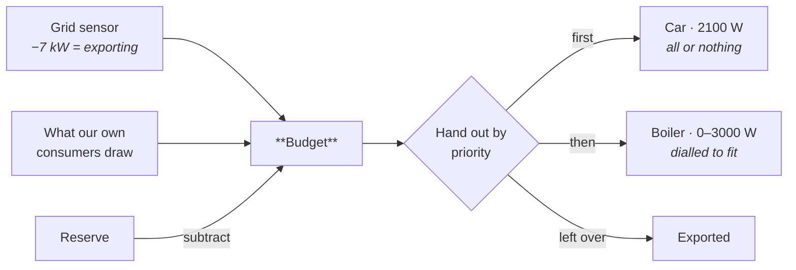

# Solar Router

[![hacs][hacs-badge]][hacs-url]
[![release][release-badge]][release-url]
[![license][license-badge]](LICENSE)

**Spend your own solar power instead of exporting it — on the things you care
about most, first.**

Most solar diverters drive one load: a boiler, and that is it. This one takes a
list of consumers, each with a **priority**, and cascades the surplus down that
list every cycle. Hot water before the car. The car before the pool pump. The
pool pump before the grid.

Point it at the sensor that reports your grid power, add your consumers, and it
works out how much you are giving away and hands it out in your order. Devices
with an adjustable power setting get dialled to whatever fits; on/off devices
get switched when their full draw fits.

Deliberately reactive, not predictive. No weather forecast, no price
optimisation; it looks at what is happening right now and divides it up. If you
want forecasting, use [EMHASS](https://github.com/davidusb-geek/emhass).



---

## Priorities are the point

A priority is just a number, and **lower is served first**. What makes it useful
is that the decision is remade every cycle against the surplus of that moment,
so the order holds no matter what the sun does.

Say the boiler is priority 10 and the car is 20, and 4 kW is coming off the roof:

| Surplus | Boiler (0–3000 W, dialled) | Car (2100 W, all or nothing) |
|--:|---|---|
| 4000 W | 3000 W — full | 1000 W left, does not fit → **off** |
| 5500 W | 3000 W — full | fits → **on** at 2100 W |
| 1200 W | 1200 W — throttled | nothing left → **off** |
| 0 W | off | off |

Flip the two priorities around and the car wins instead: it takes its 2100 W
first and the boiler gets the remainder. Same hardware, same weather, different
outcome — and it is one number in the UI.

That ordering is worth thinking about. A kilowatt-hour into hot water displaces
gas at full value; the same kilowatt-hour into a car battery comes back out with
losses, and a slow charge may not finish anyway. Which is why the boiler usually
belongs first, even though the car feels more valuable.

Two things make the order behave:

- **A consumer that cannot use its share does not block the ones below it.** An
  on/off device that does not fit is skipped and the next one gets a turn.
- **Taking a consumer out of the routing** with its **Managed** switch removes it
  from the list entirely, so everything below moves up.

## The one thing worth understanding

```
budget = current export + what our own consumers already draw − reserve
```

Adding back your own draw is essential. Without it, switching the boiler on
makes the export disappear, which looks like a shortage, which switches the
boiler off again — and round it goes. With it, the budget stays stable and each
consumer simply holds its share.

## Getting started

You need **Home Assistant 2025.3.0** or newer. Consumers are config subentries,
and those did not exist before that release.

<table>
<tr><th>With HACS</th><th>By hand</th></tr>
<tr valign="top"><td>

Not in the default store yet, so add it as a custom repository:

1. HACS → ⋮ → **Custom repositories**
2. `brtwrs/solar-router`, type **Integration**
3. Install **Solar Router**, restart

</td><td>

Copy `custom_components/solar_router` into your Home Assistant `config`
directory and restart.

</td></tr>
</table>

Then **Settings → Devices & Services → Add integration → Solar Router**.

The hub asks for one thing that matters: the sensor reporting grid power. Say
whether export shows as a negative number (usually yes). Optionally keep a
reserve in watts as a buffer, and set how often to recalculate.

Consumers are added with the **+** on the integration page:

| Field | Meaning |
|---|---|
| How is it controlled | An adjustable `number` entity, or an on/off `switch`, or both |
| Power sensor | Optional. With one, the router accounts for what a device actually draws instead of what it was told to draw |
| Minimum power | Below this it is not worth running. On/off devices: leave at 0 |
| Maximum power | The ceiling. For on/off: what it draws when running |
| Priority | **Lower number is served first** |
| Minimum on/off time | Keeps relays from chattering |

Each consumer becomes its own device with two entities: the power currently
routed to it, and a **Managed** switch to take it out of the routing when you
want to run it by hand.

## A worked example

A 10 kW roof, a boiler with an adjustable element, and a car charger.

| | Priority | Range | Min on/off | Controlled by |
|---|---|---|---|---|
| **Car** | 45 | 0–2100 W | 300 s / 300 s | `switch.car_plug` |
| **Boiler** | 50 | 0–3000 W | 0 / 0 | `number.boiler_power` |

Hub: `sensor.grid_net_power`, export negative, no reserve, recalculate every
15 s, settle 15 s, gain 1.0.

The car has the *lower* priority number, so it is served first — it needs its
full 2100 W or nothing, while the boiler happily takes whatever is left over.
The 300 s minimum on and off keep the plug from chattering on a cloudy day; the
boiler needs no such protection because dialling it costs nothing.

Set the settle time from your own meter. A P1 meter that refreshes every 10 s
and a boiler that responds in about 1.5 s means roughly 11 s of dead time, so
15 s is a sober choice. Guessing high just makes it sluggish.

## When it holds back

The router deliberately does nothing in three situations, and all three are
visible on the hub sensor's attributes:

- **Waiting for a fresh reading.** After acting, the meter still describes the
  world as it was. Deciding twice on the same measurement is how a controller
  overshoots, so it waits for a genuinely newer one. You will see
  `settling: true`.
- **Inside a minimum on/off window.** A consumer shows `held on` or `held off`.
- **The grid sensor is unreadable.** The entities go unavailable and nothing is
  touched — consumers keep their last setpoint rather than being driven on a
  guess. The log names the sensor.

## Limitations

- **An on/off consumer only starts when its full draw fits.** With 1900 W of
  surplus and a 2100 W charger, nothing happens and the surplus is exported.
- **One hub per Home Assistant.** It reasons about one grid connection.
- **Consumer state is not kept over a restart.** Managed switches go back on and
  timers start fresh — though the router reads what devices are actually set to
  rather than trusting its own bookkeeping.
- **No battery support yet.** A battery is not just another consumer; it has a
  charge level, a ceiling, and round-trip losses.

<details>
<summary><b>When it is not doing what you expect</b></summary>

Start with the hub sensor's attributes. `budget`, `unused`, `settling` and the
per-consumer `allocations` show exactly what the last cycle decided and why.

| What you see | Usually means |
|---|---|
| Entities unavailable | The grid sensor is unavailable or not numeric. The log says which. |
| `settling: true` and nothing moving | Waiting for a fresher meter reading. Lower the settle time, or accept that your meter is slow. |
| A consumer stuck at `held on` / `held off` | Its minimum on/off time has not elapsed. |
| Surplus available but an on/off device idle | Its full draw does not fit in what is left. |
| Everything oscillating | Lower the gain. 1.0 jumps straight to the target, which overshoots when the meter lags. |

For a bug report, use **Settings → Devices & Services → Solar Router → ⋮ →
Download diagnostics**. That includes the config, the last cycle, and what every
source entity read at that moment.

</details>

<details>
<summary><b>Removing it</b></summary>

**Settings → Devices & Services → Solar Router → ⋮ → Delete.** That removes the
hub, its consumers and all their entities. Nothing is left behind in Home
Assistant, and the entities the router was driving keep whatever value they last
had — check your boiler or charger afterwards if that matters.

Installed through HACS? Remove it there too, then restart.

</details>

<details>
<summary><b>Working on it</b></summary>

The allocation logic lives in `allocator.py` and imports nothing from Home
Assistant, so it runs on its own:

```bash
python -m pytest tests/ -q     # 48 tests
ruff check . && ruff format --check .
mypy
```

Lint and typing follow Home Assistant core's settings; see `pyproject.toml`.
`quality_scale.yaml` records where the integration stands against HA's
integration quality scale.

</details>

## Status

Version 0.1.0, a first release. Written and run against Home Assistant 2026.8.
The 2025.3.0 floor is where the APIs it uses first appeared, not a version it
has been tested on.

MIT licensed — see [LICENSE](LICENSE).

[hacs-badge]: https://img.shields.io/badge/HACS-custom-41BDF5.svg
[hacs-url]: https://hacs.xyz/
[release-badge]: https://img.shields.io/github/v/release/brtwrs/solar-router
[release-url]: https://github.com/brtwrs/solar-router/releases
[license-badge]: https://img.shields.io/github/license/brtwrs/solar-router
