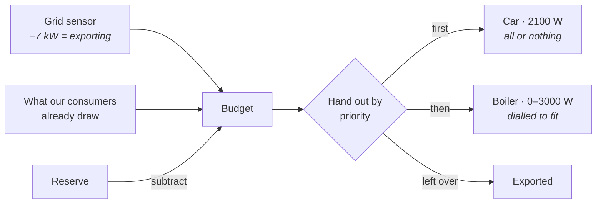

# Solar Router

[![hacs][hacs-badge]][hacs-url]
[![release][release-badge]][release-url]
[![license][license-badge]](LICENSE)

**Spend your own solar power instead of exporting it — on whatever matters most
to you, first.**

Most solar diverters drive a single load and stop there. This one takes a list
of consumers, each with a **priority**, and cascades the surplus down that list
every cycle. Hot water before the car. The car before the pool pump. The pool
pump before the grid.

Point it at the sensor that reports your grid power, add your consumers, and it
works out how much you're about to give away and spends it in your order.
Devices with an adjustable power setting are dialled to whatever fits; on/off
devices are switched on once their full draw fits.

It's reactive, not predictive. No weather forecast, no price optimisation — it
looks at what's happening right now and divides it up. If you want forecasting,
use [EMHASS](https://github.com/davidusb-geek/emhass).



---

## Priorities are the point

A priority is just a number, and **the lower one goes first**. The split is
recalculated every cycle against whatever surplus exists at that moment, so your
order holds all day without you touching anything.

Boiler on priority 10, car on 20:

| Surplus | Boiler (0–3000 W, dialled) | Car (2100 W, all or nothing) |
|--:|---|---|
| 4000 W | 3000 W, full | 1000 W left, doesn't fit → **off** |
| 5500 W | 3000 W, full | fits → **on** at 2100 W |
| 1200 W | 1200 W, throttled | nothing left → **off** |
| 0 W | off | off |

Swap the two numbers and the car wins instead: it claims its 2100 W first and
the boiler lives on the remainder. Same hardware, same weather, different
outcome, one number in the UI.

Two things worth knowing about how the list is walked:

- **A consumer that can't use its share doesn't hold up the ones below it.** An
  on/off device that doesn't fit is skipped, and the next one gets the full
  remainder.
- **Its Managed switch takes it off the list entirely**, so everything below it
  moves up.

## How the budget is worked out

```
budget = current export + what our own consumers already draw − reserve
```

Adding back your own draw is essential. Without it, switching the boiler on
makes the export disappear, which looks like a shortage, which switches the
boiler off again — and round it goes. With it, the budget stays stable and each
consumer simply holds its share.

## Getting started

You need **Home Assistant 2025.3.0** or newer. Consumers are config subentries,
which didn't exist before that release.

<table>
<tr><th>With HACS</th><th>By hand</th></tr>
<tr valign="top"><td>

Not in the default store yet, so add it as a custom repository:

1. HACS → ⋮ → **Custom repositories**
2. `brtwrs/solar-router`, type **Integration**
3. Install **Solar Router**, restart

</td><td>

Copy `custom_components/solar_router` into your Home Assistant `config`
directory and restart.

</td></tr>
</table>

Then **Settings → Devices & Services → Add integration → Solar Router**.

The hub asks for one thing that matters: the sensor reporting your grid power.
Tell it whether export shows up as a negative number (usually it does). You can
also hold back a reserve in watts as a buffer, and set how often to recalculate.

Add consumers with the **+** on the integration page:

| Field | Meaning |
|---|---|
| Control | An adjustable `number` entity, an on/off `switch`, or both |
| Power sensor | Optional, but recommended. With one, the router counts what a device actually draws rather than what it was told to draw |
| Minimum power | Below this it's not worth running. Leave at 0 for on/off devices |
| Maximum power | The ceiling. For on/off devices, what it draws when running |
| Priority | **The lower number goes first** |
| Minimum on/off time | Stops relays chattering |

Every consumer becomes its own device with two entities: the power currently
routed to it, and a **Managed** switch for taking it off the list when you want
to run it by hand.

## A worked example

A 10 kW roof, a boiler with an adjustable element, and a car charger.

| | Priority | Range | Min on/off | Controlled by |
|---|---|---|---|---|
| **Car** | 45 | 0–2100 W | 300 s / 300 s | `switch.car_plug` |
| **Boiler** | 50 | 0–3000 W | 0 / 0 | `number.boiler_power` |

Hub: `sensor.grid_net_power`, export negative, no reserve, recalculate every
15 s, settle 15 s, gain 1.0.

The car has the lower priority number, so it goes first — it needs its full
2100 W or nothing, while the boiler is happy with whatever is left. The 300 s
minimums stop the plug chattering on a cloudy day; the boiler doesn't need that,
because dialling it costs nothing.

Base the settle time on your own meter. If your P1 meter refreshes every 10 s
and the boiler responds in about 1.5 s, you have roughly 11 s of dead time, so
15 s fits. Setting it higher only makes the router sluggish.

## When it deliberately does nothing

Three situations, all visible in the hub sensor's attributes:

- **Waiting for a fresh reading.** Right after acting, the meter still describes
  the world as it was. Deciding twice on the same measurement is how a
  controller overshoots, so it waits for a genuinely newer one. You'll see
  `settling: true`.
- **Inside a minimum on/off window.** The consumer shows `held on` or
  `held off`.
- **The grid sensor can't be read.** The entities go unavailable and nothing is
  touched — consumers keep their last setpoint instead of being driven on a
  guess. The log names the sensor.

## Limitations

- **An on/off consumer only starts when its full draw fits.** With 1900 W spare
  and a 2100 W charger, nothing happens and the surplus goes to the grid.
- **One hub per Home Assistant.** It assumes a single grid connection.
- **Consumer state isn't kept across a restart.** Managed switches come back on
  and the timers start fresh, although the router reads what your devices are
  actually set to rather than trusting its own bookkeeping.
- **No battery support yet.** A battery isn't just another consumer: it has a
  charge level, a ceiling, and round-trip losses.

<details>
<summary><b>When it isn't doing what you expect</b></summary>

Start with the hub sensor's attributes. `budget`, `unused`, `settling` and the
per-consumer `allocations` show exactly what the last cycle decided, and why.

| What you see | Usually means |
|---|---|
| Entities unavailable | The grid sensor is unavailable or isn't a number. The log says which. |
| `settling: true` and nothing moving | Waiting for a fresher meter reading. Lower the settle time, or accept that your meter is slow. |
| A consumer stuck on `held on` / `held off` | Its minimum on/off time hasn't elapsed. |
| Surplus available but an on/off device idle | Its full draw doesn't fit in what's left. |
| Everything oscillating | Lower the gain. At 1.0 it jumps straight to the target, which overshoots when the meter lags. |

For a bug report, use **Settings → Devices & Services → Solar Router → ⋮ →
Download diagnostics**. It contains the config, the last cycle, and what every
source entity read at that moment.

</details>

<details>
<summary><b>Removing it</b></summary>

**Settings → Devices & Services → Solar Router → ⋮ → Delete.** That removes the
hub, its consumers and all their entities, and leaves nothing behind in Home
Assistant. Whatever the router last set on your boiler or charger stays there,
so check those afterwards if it matters.

Installed through HACS? Remove it there too, then restart.

</details>

<details>
<summary><b>Development</b></summary>

The allocation logic lives in `allocator.py` and imports nothing from Home
Assistant, so it runs on its own:

```bash
python -m pytest tests/ -q     # 48 tests
ruff check . && ruff format --check .
mypy
```

Linting and typing follow Home Assistant core's settings; see `pyproject.toml`.
`quality_scale.yaml` tracks where the integration stands against HA's
integration quality scale.

</details>

## Status

Version 0.1.0, a first release, developed and running on Home Assistant 2026.8.
The 2025.3.0 floor is where the APIs it uses first appeared, not a version it
has been tested against.

MIT licensed — see [LICENSE](LICENSE).

[hacs-badge]: https://img.shields.io/badge/HACS-custom-41BDF5.svg
[hacs-url]: https://hacs.xyz/
[release-badge]: https://img.shields.io/github/v/release/brtwrs/solar-router
[release-url]: https://github.com/brtwrs/solar-router/releases
[license-badge]: https://img.shields.io/github/license/brtwrs/solar-router
